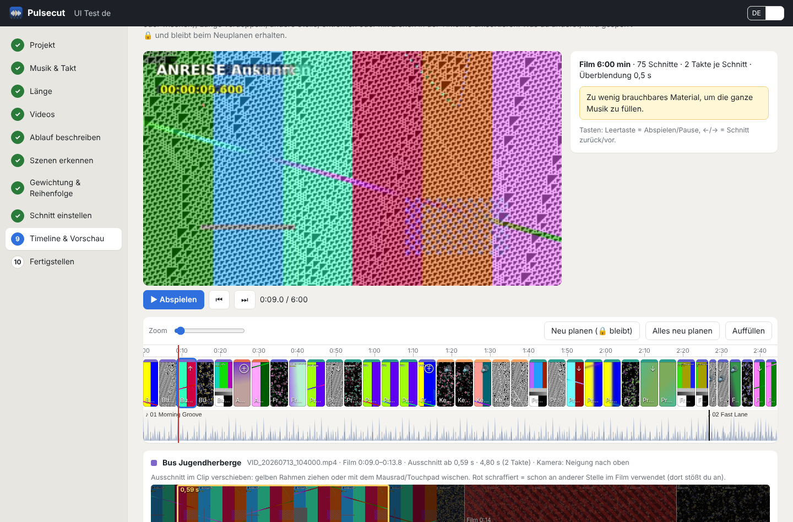

# Pulsecut

**Aus einem Haufen Handy-Videos wird ein Rückblick-Film, der genau im Takt deiner Musik geschnitten ist.**

[English](README.md) · [Download](https://github.com/doitux/pulsecut/releases/latest) · Lizenz: GPL-3.0

Pulsecut ist ein Desktop-Programm für Linux. Es ist für den langen Rückblick-Film gedacht: nach einer Freizeit,
einer Klassenfahrt, einem Vereinswochenende, einer Hochzeit oder dem Familienurlaub. Mehrere Minuten lang, aus
Hunderten unsortierten Clips, gefilmt von verschiedenen Leuten. Du beschreibst in deinen Worten, was in welcher
Reihenfolge passiert ist. Pulsecut sucht die passenden Szenen heraus, fragt nach, wenn etwas zu fehlen scheint, und
schneidet alles auf die Takte der Musik. Heraus kommt ein **Kdenlive-Projekt** zum Weiterbearbeiten und fertig
gerenderte Videos in den Formaten, die du brauchst.

Alles läuft **auf deinem Rechner**. Videos, Bilder und Ton verlassen ihn nie. Das ist wichtig, wenn Kinder zu sehen
sind.



## Ablauf

| Schritt | Was passiert |
|---|---|
| 1 Projekt | Video- und Musikordner wählen. Musik und Videos werden im Hintergrund analysiert. |
| 2 Musik & Takt | Jedes Stück mit **Klick-Spur** anhören: hoher Klick = „1“, die Kästchen zählen mit. Korrekturen: Taktanfang ±1 Schlag, Tempo halb/doppelt oder BPM vorgeben, 3/4 oder 4/4, Feinversatz. Reihenfolge der Stücke, Stücke ab- und anwählen, **direkt nacheinander oder mit Überblendung**. |
| 3 Länge | Ganze Musik oder bestimmte Länge. Ist die Musik zu lang: je Stück *nicht / vorne / hinten kürzen*. Gekürzt wird immer an einem Taktanfang. |
| 4 Videos | Reihenfolge nach Aufnahmezeit (Handy-Metadaten) oder Dateiname. Clips auf *Raus* oder *Wichtig* setzen. |
| 5 Ablauf | Per **Mikrofon** oder Tastatur beschreiben, was in welcher Reihenfolge passiert ist. Daraus werden Stichworte. „jeden Tag“ oder „zwischendurch“ heißt: kommt mehrmals vor. Deutsch und Englisch werden erkannt. |
| 6 Szenen erkennen | Die KI ordnet die Videos den Stichworten zu und berücksichtigt dabei die beschriebene Reihenfolge. Unsichere Szenen sind markiert. Bei vermutlich vergessenen Programmpunkten fragt sie nach: „Ist da nicht noch *Party / Disco* dabei gewesen?“ |
| 7 Gewichtung & Reihenfolge | Anteil je Stichwort, je Szene *Raus … Viel mehr*, ganze Blöcke verschieben (z. B. *Gruppenfoto hinter Abschlusskonzert*), einzelne Clips oder Schnitte abwählen. |
| 8 Schnitt einstellen | Schnittlänge in Takten (oder halben Takten), **harte Schnitte oder Überblendung** mit Länge, Option Kamerabewegung, Titel und Abspann. **Originalton:** *Nur Musik* · *Stimmung dazu, Musik bleibt* · *Stimmung dazu, Musik leiser*. Lachen, Applaus, Jubel, Stimmen und Gruppengeräusche werden erkannt und weich ein- und ausgeblendet, aber nie, wo im Video Musik läuft (Proben, Konzerte). Je Clip lässt sich der Ton auf An oder Aus stellen. |
| 9 Timeline & Vorschau | Live-Vorschau mit Abspielbalken. Ausschnitt per Ziehen oder Wischen im Clip verschieben (die Länge bleibt im Takt). Stößt er an einen anderen Schnitt aus demselben Clip, fragt Pulsecut, ob du den aufgeben willst. Länge ×2/×3, Umsortieren, andere Stelle, Entfernen. Was du änderst, wird gesperrt 🔒 und bleibt beim Neuplanen erhalten. |
| 10 Fertigstellen | Kdenlive-Projekt plus Videos: Full HD, 4K, 720p, Hochformat 9:16, Master (ProRes). |

**Regeln, die immer gelten:** Zwei Ausschnitte aus demselben Clip überlappen sich nie. Innerhalb einer Szene läuft
alles chronologisch. Aufeinanderfolgende Schnitte bevorzugen gegenläufige oder andere Kamerabewegungen (auf Wunsch
auch auf Kosten der Zeitfolge).

Die Oberfläche gibt es auf **Deutsch und Englisch** (Umschalter oben rechts).

## Was ist anders als bei anderen Beat-Tools?

Die meisten Beat-Sync-Werkzeuge setzen Marker auf den Takt und überlassen dir die Auswahl der Clips (BeatEdit für
Premiere, BeatMark für Final Cut) oder suchen „Highlights“ für einen 30-Sekunden-Clip (GoPro Quik, CapCut, Beatleap).
Pulsecut macht etwas anderes: einen mehrminütigen, **erzählten** Rückblick aus viel Laienmaterial, nach deiner
Beschreibung, mit festen Schnittregeln, lokal und datensparsam, mit offenem Kdenlive-Projekt als Ergebnis. Für einen
schnellen Reel vom Handy ist eine Handy-App schneller, für den langen Film ist Pulsecut gemacht.

## Installation (Linux, x86-64)

1. Einmalig die Werkzeuge installieren (sind mit Kdenlive meist schon da):

   ```bash
   sudo apt install ffmpeg melt
   ```

2. `Pulsecut-<Version>-x86_64.AppImage` von den
   [Releases](https://github.com/doitux/pulsecut/releases/latest) herunterladen, ausführbar machen (Dolphin:
   Rechtsklick → *Eigenschaften* → *Berechtigungen* → *Ausführbar*) und per Doppelklick starten:

   ```bash
   chmod +x Pulsecut-*-x86_64.AppImage
   ./Pulsecut-*-x86_64.AppImage
   ```

   Auf der Startseite bietet Pulsecut an, sich ins Startmenü einzutragen.

Python, Qt und alle Bibliotheken stecken im AppImage. Es läuft auf Systemen mit glibc 2.35 oder neuer
(Ubuntu/Kubuntu 22.04+, Debian 12+, Fedora 36+ …).

### KI-Erkennung (optional, einmalig)

Für Bild- und Geräuscherkennung und die Spracheingabe richtet Pulsecut beim ersten Mal eine eigene KI-Umgebung ein
(Schritt 6, Knopf *KI-Erkennung einrichten*): PyTorch für den Prozessor und drei Modelle, zusammen ca. 1,5 GB, in
`~/.local/share/pulsecut/ki-umgebung` und `~/.cache/huggingface`. Danach läuft alles offline. Ohne KI werden die
Szenen an den größten Zeitlücken auf deine Stichworte verteilt, und du korrigierst die Zuordnung per Auswahlliste.

## Wenn etwas nicht klappt

| Problem | Lösung |
|---|---|
| Programmfenster bleibt weiß oder schwarz (Grafiktreiber) | Pulsecut merkt das, startet von selbst neu ohne Vulkan, notfalls ohne Grafikbeschleunigung, und merkt sich die Einstellung. Von Hand: `PULSECUT_GRAFIK=opengl` oder `PULSECUT_GRAFIK=software` (zurück: `PULSECUT_GRAFIK=gpu`) |
| Lieber im normalen Browser arbeiten | `./Pulsecut-*.AppImage --browser` |
| AppImage startet nicht („FUSE“) | `./Pulsecut-*.AppImage --appimage-extract-and-run` |
| Projekt direkt öffnen | `./Pulsecut-*.AppImage /pfad/zum/Projekt_Pulsecut` |
| Sprache festlegen | `./Pulsecut-*.AppImage --lang de` (oder `en`) |
| KI-Einrichtung bricht ab | Internetverbindung prüfen, Knopf erneut drücken. Das Protokoll steht direkt darunter. |
| Beats sitzen nicht | in Schritt 2 korrigieren. Kennst du das Tempo, trag die BPM ein. |
| Überblendungen fehlen im Video | `melt` fehlt: `sudo apt install melt` |

Projekte vom Vorgänger *Taktschnitt 1.0* lassen sich direkt öffnen, auch eine dort schon eingerichtete KI-Umgebung
wird übernommen.

## Dateien

Pulsecut legt neben deinem Videoordner einen Projektordner `<Name>_Pulsecut` an: `pulsecut.json` enthält alle
Entscheidungen (Musik-Korrekturen, Stichworte, Gewichte, Szenen, Timeline mit Sperren), `cache/` Analyse und
Vorschau-Videos (darf gelöscht werden), `export/` das Kdenlive-Projekt und die gerenderten Videos. Deine
Original-Videos und die Musik werden nie verändert.

## Mitentwickeln

Siehe [README.md](README.md#development) (englisch). Kurz: `python3 -m pulsecut` startet aus dem Quellcode,
`python3 -m pytest` führt die Tests aus (beim ersten Mal wird synthetisches Testmaterial erzeugt),
`python3 tools/i18n_keys.py` prüft, ob jeder Text übersetzt ist. Neue Texte auf Deutsch in `T("…")` (JavaScript) bzw.
`_t("…")` (Python) schreiben und die englische Fassung in `pulsecut/ui/i18n.js` bzw. `pulsecut/i18n.py` ergänzen.

## Lizenz

Copyright © 2026 René Wodrich und Mitwirkende. Pulsecut ist freie Software unter der
[GNU General Public License v3.0](LICENSE).
