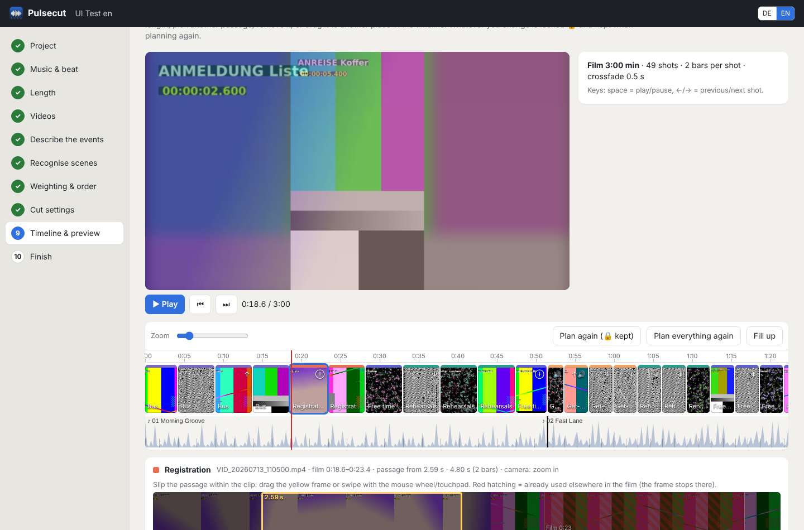

# Pulsecut

**Turn a pile of phone videos into a recap film that is cut exactly to the beat of your music.**

[Deutsch](README.de.md) · [Download](https://github.com/doitux/pulsecut/releases/latest) · License: GPL-3.0

Pulsecut is a desktop app for Linux. It is made for the long recap film after a camp, a class trip, a club
weekend, a wedding or a family holiday: several minutes long, made from hundreds of unsorted clips filmed by
different people. You describe in your own words what happened in which order. Pulsecut finds the matching scenes,
asks back when something seems to be missing, and cuts everything on the bars of the music. The result is a
**Kdenlive project** you can keep editing, plus rendered videos in the formats you need.

Everything runs **locally on your computer**. Videos, pictures and sound never leave it. That matters when the
footage shows children.



## What it does

1. **Music first.** Pulsecut measures bars and beats of every track (HMM beat tracker with downbeat detection). You
   check the result with a click track and can correct the downbeat, tempo (half/double/BPM), time signature and a
   fine offset. Tracks can follow each other directly or with a subtle crossfade.
2. **Length.** Use all of the music or a target length. You choose which track is shortened at the start or at the
   end; cuts always happen at the start of a bar.
3. **Videos** are sorted by recording time from the phone metadata, or by file name. The analysis runs quietly in
   the background; a *⚡ Full power* switch uses all processor cores. Image quality, changes of view
   and camera motion (pans, tilts, zooms) are analysed.
4. **Describe the events**, typed or spoken: *“First everyone arrives by bus, then registration. Every day
   rehearsals, in between free time with football. On the last day the final concert, after that the group
   photo.”* This becomes an ordered list of keywords; “every day” or “in between” marks a keyword as recurring.
5. **Recognise scenes.** A local AI (CLIP) compares every clip with your keywords and combines this with the order you
   described. Uncertain scenes are marked. If footage seems to belong to something you did not mention, Pulsecut asks:
   *“Wasn't there also a party / disco?”*
6. **Weighting and order.** Give each keyword more or less room, boost or drop single scenes, move whole blocks
   (e.g. the group photo after the concert), deselect clips or single shots.
7. **Cut.** Every shot lasts the same number of bars (or half bars). Hard cuts or crossfades of any length. Hard rules
   that always hold:
   - two passages from the same clip never overlap,
   - within a scene everything runs in chronological order,
   - consecutive shots prefer opposite or different camera motion (optionally even at the expense of chronology).
8. **Timeline and live preview.** Play the film with a playhead. Slip a shot's passage within its clip by dragging
   or swiping (its length stays on the beat); if it bumps into a neighbouring shot from the same clip, Pulsecut asks
   whether to give the neighbour up. Double or triple a shot's length, reorder by dragging, suggest another passage,
   remove. Everything you change is locked and survives re-planning.
9. **Title and credits** in 12 styles (band, card, glass, lines, frame, lower third, highlighter, glow, outline,
   cinema …) with any installed font and an accent colour – chosen from a gallery rendered on your own footage.
10. **Original sound.** Three options: *music only*; *atmosphere added, music stays*; *atmosphere added, music
   quieter*. Laughter, applause, cheering, voices and crowd sounds are detected and faded in and out softly – but
   never where music can be heard in the video (rehearsals, concerts). Per clip the sound can be set to on or off.
11. **Finish.** A Kdenlive project (A/B tracks for crossfades, music with bar markers, guides per keyword, titles,
   original sound on its own tracks) and renders in Full HD, 4K, 720p, portrait 9:16 and ProRes master.

The interface is available in **English and German** (switch at the top right).

## How it compares

Beat-sync tools are common. Most of them put markers on the beat and leave choosing the footage to you
(BeatEdit for Premiere, BeatMark for Final Cut), or pick “highlights” for a 30-second social media clip
(GoPro Quik, CapCut, Beatleap). Pulsecut is built for a different job:

| | Pulsecut | typical beat-sync tools |
|---|---|---|
| Output | multi-minute recap with a story structure | short reel, or markers only |
| Footage | hundreds of unsorted clips from several phones | a few selected clips |
| Structure | follows your spoken/typed description, asks about forgotten parts | none, or “highlights” |
| Editing rules | chronology per scene, no repeated passages, camera motion alternation | — |
| Result | editable Kdenlive project + renders | finished file in a closed app |
| Privacy | AI runs offline on your computer | often cloud |
| Platform / licence | Linux, GPL-3.0, free | mostly Windows/macOS/mobile, commercial |

For a quick 30-second reel from your phone, a mobile app is faster. Pulsecut is for the longer film.

## Installation (Linux x86-64)

1. Install the helper programs once (they usually come with Kdenlive):

   ```bash
   sudo apt install ffmpeg melt
   ```

2. Download `Pulsecut-<version>-x86_64.AppImage` from the
   [releases](https://github.com/doitux/pulsecut/releases/latest), make it executable and start it:

   ```bash
   chmod +x Pulsecut-*-x86_64.AppImage
   ./Pulsecut-*-x86_64.AppImage
   ```

   On the start page Pulsecut offers to add itself to the application menu.

Python, Qt and all libraries are inside the AppImage. Built on Ubuntu 22.04, it runs on distributions with glibc 2.35
or newer (Ubuntu/Kubuntu 22.04+, Debian 12+, Fedora 36+ …).

### AI recognition (optional, one-time)

For image and sound recognition and voice input, Pulsecut sets up its own AI environment the first time
(step 6, button *Set up AI recognition*): PyTorch for the CPU and three models (CLIP for images, AST for sounds,
Whisper for speech), about 1.5 GB in total, stored in `~/.local/share/pulsecut/ki-umgebung` and
`~/.cache/huggingface`. After that everything works offline. Without AI, scenes are split at the largest time gaps
and you assign them yourself.

## Troubleshooting

| Problem | Solution |
|---|---|
| Window stays white or black (graphics driver) | Pulsecut notices this and restarts itself without Vulkan, then without GPU acceleration, and remembers the setting. To choose by hand: `PULSECUT_GRAFIK=opengl` or `PULSECUT_GRAFIK=software` (back to normal: `PULSECUT_GRAFIK=gpu`) |
| Prefer your normal web browser | `./Pulsecut-*.AppImage --browser` |
| AppImage does not start (“FUSE”) | `./Pulsecut-*.AppImage --appimage-extract-and-run` |
| Open a project directly | `./Pulsecut-*.AppImage /path/to/Project_Pulsecut` |
| Force a language | `./Pulsecut-*.AppImage --lang en` (or `de`) |
| Beats are off | correct them in step 2; if you know the tempo, enter the BPM |
| Crossfades missing in the video | `melt` is missing: `sudo apt install melt` |

Projects of the predecessor *Taktschnitt 1.0* open directly (the old `taktschnitt.json` is taken over).

## Files

Pulsecut creates a project folder `<Name>_Pulsecut` next to your video folder: `pulsecut.json` holds all decisions
(music corrections, keywords, weights, scenes, timeline with locks), `cache/` holds analysis results and preview
proxies (can be deleted), `export/` the Kdenlive project and renders. Your original videos and music are never
changed.

## Development

```bash
git clone https://github.com/doitux/pulsecut && cd pulsecut
pip install PySide6 numpy pytest playwright        # PySide6 only for the app window
sudo apt install ffmpeg melt
python3 -m pulsecut                                # start from source (or --browser)
python3 -m pytest                                  # tests (first run generates synthetic test footage)
python3 -m pytest -m "not slow and not ui"         # quick run
python3 tools/i18n_keys.py                         # check that every text has a translation
```

```text
pulsecut/
  app.py        start, Qt window (QtWebEngine + WebChannel for native dialogs, microphone permission)
  server.py     local HTTP server (127.0.0.1 only) with a JSON API
  projekt.py    project state, background jobs, all steps, timeline editing
  musik.py      beat/bar tracking (HMM), track arrangement, click track, preview mix
  video.py      video analysis (quality, views, camera motion), preview proxies
  erkennung.py  keywords from German/English text, clip → keyword assignment, scenes, follow-up questions
  planer.py     cut planning with hard rules, repair, slip ranges
  export.py     Kdenlive/MLT project (A/B tracks), titles, rendering with melt or ffmpeg
  i18n.py       German/English texts of the Python side (the UI has ui/i18n.js)
  ki.py, ki_worker.py   AI environment (uv) and worker (sentence-transformers CLIP, AST, faster-whisper)
  ui/           interface (HTML/CSS/JavaScript, no build step)
packaging/      PyInstaller spec, Qt pruning, AppImage build
tests/          synthetic footage generator, simulated AI, core/fuzz/export/UI tests
```

Much of the code uses German identifiers (the project started as a German tool); comments for contributors are
welcome in English or German. German is the source language for UI texts: wrap a new text in `T("…")` (JavaScript)
or `_t("…")` (Python) and add the English version to `pulsecut/ui/i18n.js` or `pulsecut/i18n.py`.

**Continuous integration:** every push runs the test suite (including browser tests in both languages and real
rendering). A separate workflow sets up the real AI environment and runs the recognition with the actual models.
The Release workflow (started by hand with a tag like `v1.0.0`, or by pushing such a tag) builds the AppImage on Ubuntu 22.04, smoke-tests it including the Qt window and publishes it with a SHA-256 checksum as a GitHub release.

## License

Copyright © 2026 René Wodrich and contributors. Pulsecut is free software under the
[GNU General Public License v3.0](LICENSE).
